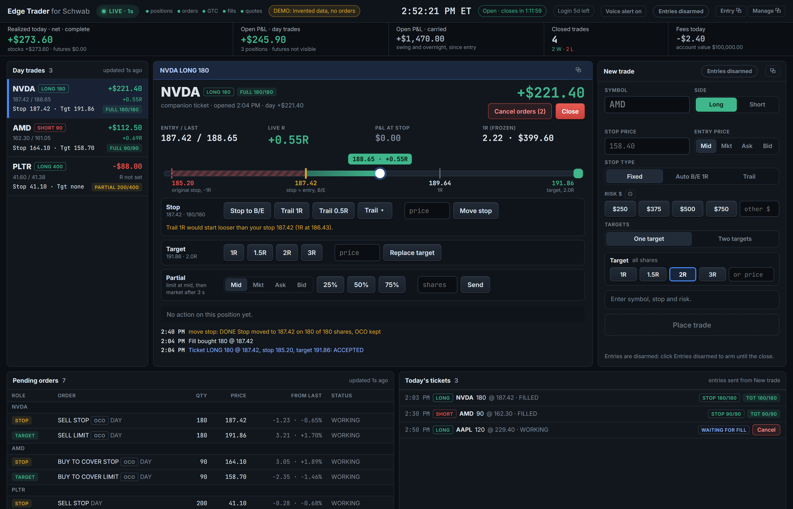
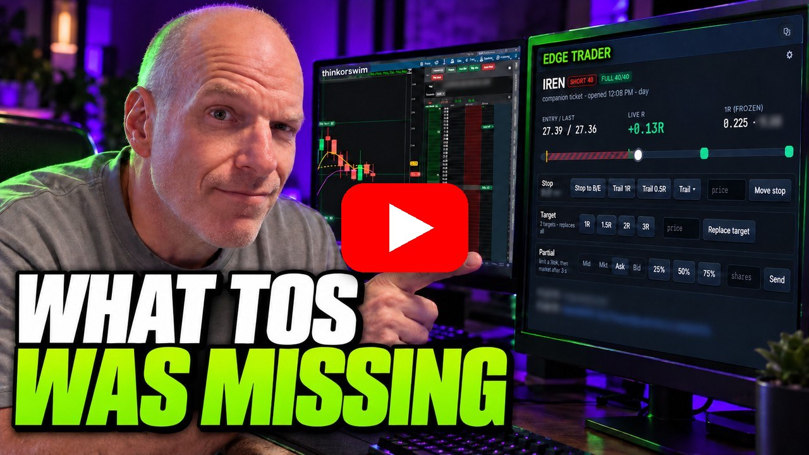
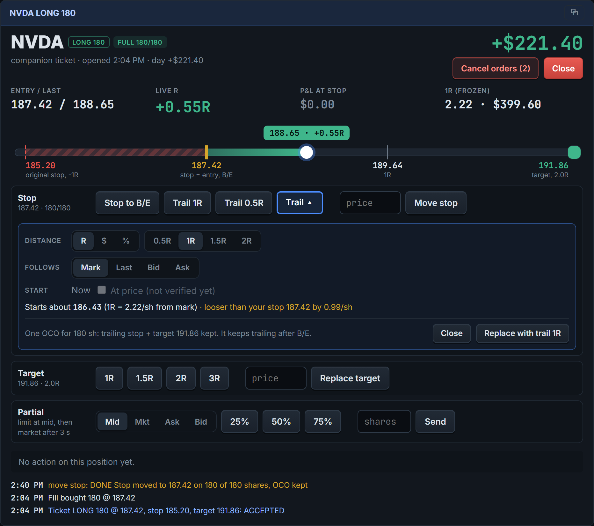
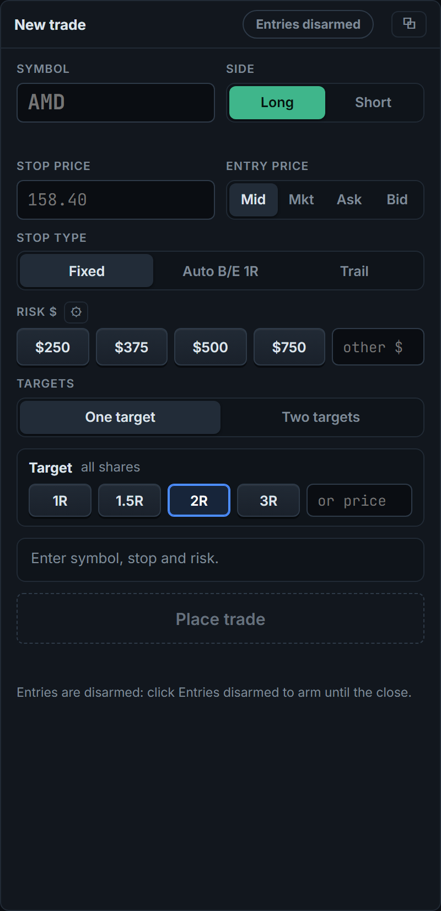
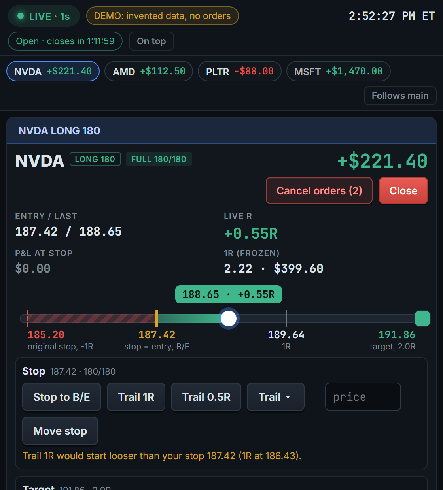

# Edge Trader for Schwab

[](https://github.com/simonro/edge-trader-for-schwab/actions/workflows/ci.yml)
[](https://github.com/simonro/edge-trader-for-schwab/releases/latest)
[](LICENSE)
[](https://youtu.be/41VQNmCN2r4)

A local day-trading dashboard and one-click order ticket for a Charles Schwab account, built on the
Schwab Trader API. It shows your open positions with live R, open and realized P&L and every working
order, and lets you enter a fully protected bracket (entry, stop and target, sized from the dollars you
want to risk) and manage it with one click: stop to break-even, move the stop, trail it, replace the
target, take partials, cancel or close. It runs on your own computer, next to thinkorswim or your charts.

- **Your data stays on your computer.** No account with us, no cloud, no telemetry. The app talks only to Schwab.
- **Every order is your click.** Nothing is sent on its own: no automation, no signals, no auto-trading.
- **Protection first.** Entries go in as one Schwab bracket, so the stop and target live at Schwab even if the app or your PC is off.
- **Honest numbers.** P&L comes from your own fills, and anything incomplete is labeled as such, never shown as complete.
- **Free and MIT licensed.** No paid tier.

**[Quick start](#quick-start)** · **[Your Schwab app](#your-schwab-app)** · **[Releases](https://github.com/simonro/edge-trader-for-schwab/releases)** · **[Privacy](#privacy-and-your-data)**

**What this is not:** not financial advice, not a signal service, not affiliated with or endorsed by
Charles Schwab. Every screenshot below is invented demo data, not anyone's real account.



[](https://youtu.be/41VQNmCN2r4)

**[Watch the walkthrough first](https://youtu.be/41VQNmCN2r4)** on the Tape to Edge YouTube channel: a full tour on a live account, from sizing the shares from your risk and sending the bracket to partials that rebuild your stop and target, then the setup and the limits.

## Built on Schwabdev

Edge Trader connects to Schwab through **[Schwabdev](https://github.com/tylerebowers/Schwabdev)** by
**Tyler Bowers** (MIT licence), the Python client for the Schwab Trader API. Schwabdev handles the
Schwab sign-in (OAuth), the token refresh and the API calls. Thank you, Tyler. If Edge Trader is useful
to you, consider starring Schwabdev too.

## Privacy and your data

Edge Trader runs on your own computer and listens on `127.0.0.1` only (requests with any other host
name are refused). It needs no account and sends no telemetry.

### What stays local

- Your Schwab tokens (`~/.schwabdev/tokens.db`, managed by Schwabdev) and your app key and secret (`.env`).
- Everything the app records: positions, orders, fills, the action log and your settings, in `data/companion.db`.

### What leaves your computer

- **Schwab** (`api.schwabapi.com`): the Trader API calls that read your account and send the orders you click.
- **GitHub** (`api.github.com`), once a day: a check for a newer Edge Trader release. It only shows a
  notice; it never downloads or installs anything. Turn it off with `EDGE_TRADER_NO_UPDATE_CHECK=1` in `.env`.
- **Google Fonts**: the page loads the Inter and JetBrains Mono fonts. Offline it falls back to system fonts.

### API keys

Keys live in `.env` on your machine, which is never committed. Do not share or commit `.env`, the
`data` folder, the tokens file, or screenshots of your real account.

## What's inside

- **Dashboard:** open positions (day trades and carried positions apart) with open P&L, live R, stop
  and target, protection (FULL, PARTIAL, NO STOP SEEN) and P&L at the stop; working orders including
  brackets and GTC orders; closed trades and realized P&L from your fills; a health light (LIVE,
  STALE, DISCONNECTED) that disables every order button when data is not current.
- **New trade:** symbol, side, stop, risk in dollars (four buttons you set yourself), entry at the mid,
  market, ask or bid, one or two targets by R or by price, and a fixed, trailing or "auto break-even at
  1R" stop. One click sends one Schwab bracket. Entries must be armed each session.
- **Workbench for the selected trade:** an R ruler (original stop, current stop, entry, 1R, targets,
  price), stop to break-even, move stop, Schwab-held trailing stop (R, dollars or percent), replace
  target, partials at the mid, market, ask or bid (the stop and target are rebuilt on the rest), cancel
  orders and close.
- **Floating windows:** small always-on-top Entry and Manage windows to keep next to your charts.
- **Market clock** with the session countdown (Schwab's calendar, holidays and early closes) and an
  optional spoken alert 10 minutes before the close if day trades are still open.
- **Safety rails:** no order is ever retried automatically; an order with an unclear outcome blocks
  further orders for that symbol until Schwab confirms it or you press Resolve; the app never opens
  Schwab's streamer, so it never disconnects another app that uses it.

## Screenshots

**The selected trade.** The R ruler shows where price sits between your original stop, the current
stop and the target. Trail options open in place, with where the trail would start and a warning when
it would be looser than your stop.



**New trade.** Pick the risk, the entry price and the targets; the plan shows the exact orders and the
risk before you send.



**Manage window.** The same controls in a small always-on-top window.



## Your Schwab app

Edge Trader uses your own Schwab developer app. You need it once:

1. Sign in at [developer.schwab.com](https://developer.schwab.com) with your Schwab login and create an
   app with the **Accounts and Trading Production** product (the Trader API).
2. Set its **Callback URL** to `https://127.0.0.1` (or any URL you also put in `.env`).
3. Wait for the app's status to show **Ready For Use** (Schwab reviews new apps; it can take a few days).
4. Open the app (**Modify App**) and check its **Order Limit** is above 0. With 0, every order is
   refused with HTTP 429 even though everything else works.
5. Copy the **App Key** and **Secret** into `.env`.

## Quick start

Requirements: Windows 10 or 11 and [Python 3.11 or newer](https://www.python.org/downloads/)
(tick "Add python.exe to PATH" when installing). Mac and Linux work with the manual steps.

**Windows:** download or clone this repo, then

1. `setup.bat`, once. It creates `.venv`, installs Schwabdev, FastAPI and the rest, and creates `.env`.
2. Put your Schwab App Key and Secret in `.env` (see [Your Schwab app](#your-schwab-app)).
3. `login.bat`. It opens Schwab's sign-in page through Schwabdev; approve, then paste the address of
   the page you land on (it will not load, that is expected). Repeat about once a week: Schwab's
   sign-in lasts 7 days.
4. `launch.bat`, every time. It opens http://127.0.0.1:8770. `stop.bat` stops it.

**Manual setup (Mac, Linux, or if you prefer):**

```bash
python -m venv .venv
.venv/bin/python -m pip install -r requirements.txt     # Windows: .venv\Scripts\python.exe
cp .env.example .env                                     # then put your App Key and Secret in it
.venv/bin/python -m companion.login                      # sign in to Schwab
.venv/bin/python -m companion                            # then open http://127.0.0.1:8770
```

Every install starts empty: Edge Trader shows only what your Schwab account reports, and keeps
nothing from anyone else.

## Updating to a new release

Your data (`data/`), your keys (`.env`) and your Schwab tokens are not part of a release, so an update
never touches them. Stop the app first (`stop.bat`).

**If you cloned with git:** `git pull`, then `setup.bat` if requirements changed, then `launch.bat`.

**If you downloaded the ZIP:** unzip the new version into a new folder, copy `.env` and the `data`
folder across, run `setup.bat` once, then `launch.bat`.

## Configuration

| Variable | What it does |
|---|---|
| `SCHWAB_APP_KEY`, `SCHWAB_APP_SECRET` | Your Schwab app (required). |
| `SCHWAB_CALLBACK_URL` | Must match your app's callback URL. Default `https://127.0.0.1`. |
| `SCHWAB_TOKENS_DB` | Where Schwabdev keeps the tokens. Default `~/.schwabdev/tokens.db`. |
| `SCHWAB_ENV_FILE` | Read the keys from another app's `.env`, to share one Schwab sign-in between apps. |
| `COMPANION_PORT` | The local port. Default `8770`. |
| `EDGE_TRADER_NO_UPDATE_CHECK` | `1` turns off the daily check for a newer release. |

## Good to know

- **Futures:** Schwab's API reports futures fills but not futures positions or orders, so Edge Trader
  shows futures realized P&L only and cannot trade futures.
- **Options:** shown and manageable (close, cancel, stops, partials, targets by price); the New trade
  ticket and trailing stops are for stocks.
- **One stream per Schwab user:** Edge Trader polls (REST) and never opens Schwab's streamer, so it
  works alongside thinkorswim and other tools. It keeps its own requests well under Schwab's limits.
- **Schwab cancels a symbol's working orders when a new order for it is entered.** Edge Trader is built
  around that: partials, target changes and trails send one new bracket for the remaining shares.
- **Planned risk is not maximum loss:** a stop becomes a market order when it triggers and can fill
  past its price on a gap or a halt.

## Contributing

Bug reports and pull requests are welcome. [CONTRIBUTING.md](CONTRIBUTING.md) covers setup, tests and
the safety rules every change must keep. Please report security problems privately, as described in
[SECURITY.md](SECURITY.md), not in a public issue.

## Who made this

A day trader who wanted one-click, defined-risk brackets and fast trade management on Schwab, next to
his charts. Built by describing the problems to Claude Code.

- YouTube: [@tapetoedge](https://www.youtube.com/@tapetoedge)
- X: [@tapetoedge](https://x.com/tapetoedge)

Educational software, not financial advice. Not affiliated with Charles Schwab. No affiliate
relationship with anything shown here. You are responsible for your own trading decisions and every
order you send, and the software comes with no warranty.

## License

MIT. See [LICENSE](LICENSE). Schwabdev is MIT licensed by Tyler Bowers.
